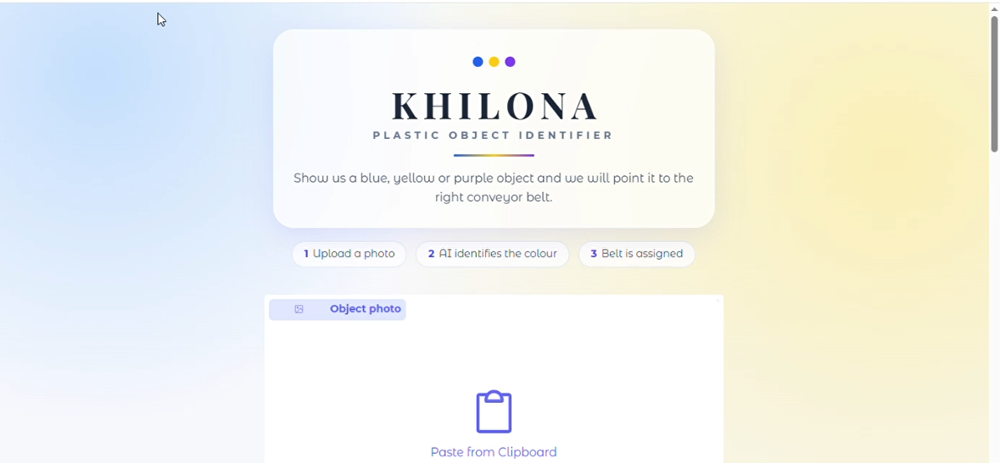

# 🧸 KHILONA: Plastic Object Identifier & Sorting System

[]()
[]()
[]()

An automated deep learning classification and routing web application developed for **KHILONA**, a leading toy factory specializing in high-quality toy parts. This system classifies incoming plastic objects by color using a custom Convolutional Neural Network (CNN) trained completely from scratch and maps them to their respective conveyor belts without using any pre-trained models or rule-based `if-else` branching.

---

## 🏭 Project Overview & Problem Statement

At the KHILONA manufacturing facility, sorting plastic components efficiently is crucial for production. The automated conveyor belt system sorts incoming plastic objects into three distinct streams based on color:
* 🔵 **Blue Objects** $\rightarrow$ **Conveyor Belt A**
* 🟡 **Yellow Objects** $\rightarrow$ **Conveyor Belt B**
* 🟣 **Purple Objects** $\rightarrow$ **Conveyor Belt C**

### Key Constraints & Design Principles:
* **Custom Dataset:** Built entirely from scratch using real-world photos captured by us (no internet or public datasets like ImageNet used).
* **No Pretrained Weights:** Trained completely from scratch; all network weights start random and are learned solely from our collected dataset.
* **No Data Augmentation:** Relied strictly on authentic physical variations in lighting, background angles, and object positions rather than synthetic image transforms.
* **Zero `if-else` Logic for Prediction:** Uses dynamic array mapping and list index lookups for clean, conditional-free model inference.
* **Dual Interfaces:** Includes both a command-line interpreter (`predict.py`) and an elegant light-theme Gradio web interface (`app.py`) featuring an interactive 3D factory visualization (`scene.html`).

---

## 🎥 Project Demo

[](https://github.com/Ahmed291005/KHILONA-Plastic-Object-Identifier-/raw/main/demo.mp4)

---

## 📂 Repository Structure

```text
KHILONA-Plastic-Object-Identifier/
│
├── dataset/                    # Custom dataset directory
│   ├── train/                  # Training split (80%)
│   │   ├── A_blue/             # Blue objects (Class 0)
│   │   ├── B_yellow/           # Yellow objects (Class 1)
│   │   └── C_purple/           # Purple objects (Class 2)
│   └── test/                   # Testing split (20%)
│       ├── A_blue/
│       ├── B_yellow/
│       └── C_purple/
│
├── khilona_model.keras         # Saved trained CNN model file
├── app.py                      # Gradio web application script
├── scene.html                  # Interactive 3D factory visualization component
├── train.py                    # Model training script
├── predict.py                  # CLI prediction module
└── README.md                   # Project documentation

```

---

## 📊 Dataset Creation & Preparation

The dataset was curated manually by capturing physical objects under diverse conditions (different backgrounds, angles, and ambient lighting) to ensure the model learns true color features.

* **Total Images:** 300 photos collected across all classes.


* **Train/Test Split:** Randomly split into **240 training images (80%)** and **60 test images (20%)** using a fixed seed (`seed=42`).


* **Validation Split:** 20% of the training set was set aside for validation during training epochs.


| Class Folder Name | Target Conveyor Belt | Train Images | Test Images | Total Images |
| --- | --- | --- | --- | --- |
| `A_blue`

 | Conveyor Belt A

 | 80

 | 20

 | 100 |
| `B_yellow`

 | Conveyor Belt B

 | 80

 | 20

 | 100 |
| `C_purple`

 | Conveyor Belt C

 | 80

 | 20

 | 100 |
| **Total** |  | **240**

 | **60**

 | **300** |

---

## 🧠 Model Architecture & Training

The CNN model uses a sequential architecture designed with progressive feature-extraction blocks:

1. **Rescaling Layer:** Normalizes pixel values from $[0, 255]$ to $[0, 1]$.


2. **Conv2D Block 1:** 16 filters ($3 \times 3$ kernel, ReLU activation) followed by Max Pooling ($2 \times 2$).


3. **Conv2D Block 2:** 32 filters ($3 \times 3$ kernel, ReLU activation) followed by Max Pooling ($2 \times 2$).


4. **Conv2D Block 3:** 64 filters ($3 \times 3$ kernel, ReLU activation) followed by Max Pooling ($2 \times 2$).


5. **Flatten Layer:** Converts multi-dimensional feature maps into a 1D feature vector.


6. **Dense Layer:** 64 units with ReLU activation.


7. **Output Layer:** 3 units with **Softmax** activation to output multi-class probability distributions.


* **Optimizer:** Adam


* **Loss Function:** Sparse Categorical Crossentropy


* **Epochs:** 10


* **Final Test Accuracy:** **93.33%**


---

## 🚀 Getting Started & Installation

### 1. Prerequisites

Ensure you have Python installed on your system (Python 3.10 or higher recommended).

### 2. Clone Repository & Install Dependencies

Open your terminal and install the required packages:

```bash
pip install tensorflow pillow gradio numpy

```

### 3. Train the Model (Optional)

If you wish to retrain the CNN model from scratch using the image directory:

```bash
python train.py

```

*(This compiles the model architecture, trains on the dataset, evaluates test accuracy, and exports `khilona_model.keras`)*.

### 4. Run CLI Prediction (Without Conditional Statements)

To test an image through the command-line interface (utilizing direct list index lookup instead of `if-else` blocks):

```bash
python predict.py

```

Enter the absolute path to your test image when prompted.

### 5. Launch the Web Application Dashboard

To run the interactive Gradio web interface featuring live classification and 3D sorting visuals:

```bash
python app.py

```

Open the local URL generated in your terminal (typically `http://127.0.0.1:7860`) in your web browser.
